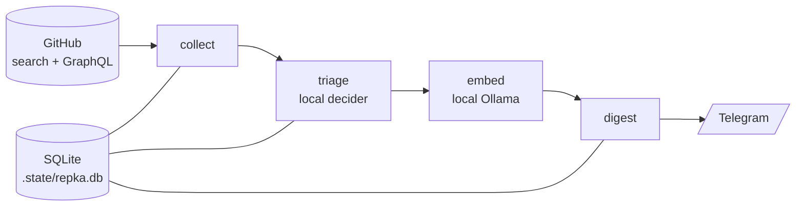

<div align="center">

# repka deda

**A private GitHub radar. Tell it what you care about; it reads GitHub for you and sends a Telegram digest of what is new.**

Local models decide what is relevant. Nothing leaves your Mac except GitHub API calls and the digest itself.

[](https://docs.astral.sh/uv/)
[](docs/getting-started.md#requirements)
[](#why-repka)
[](docs/configuration.md)
[](#using-it-with-an-ai-agent)

[Sample digest](#what-lands-in-your-telegram) ·
[Try it](#try-it-in-5-minutes) ·
[Use it with an AI agent](#using-it-with-an-ai-agent) ·
[User guides](#user-guides) ·
[Troubleshooting](docs/troubleshooting.md)

</div>

---

## ❌ Without repka

- You skim trending pages, star lists and newsletters, and still miss the repo that mattered.
- A GitHub search for "mcp server" returns over a thousand repositories per language. Most are noise.
- Releases, star spikes and dependency changes of the projects you follow are scattered over a dozen places.

## ✅ With repka

You describe a technology area once (a **domain**, for example "AI agent harnesses" or "MCP servers"). Twice a day
repka finds new and fast-growing repositories in it, lets a local decider model drop the irrelevant ones, and sends
you one short digest: 🆕 new repos, 📈 star spikes, 🧩 stack changes and 🚀 releases.

## What lands in your Telegram

A digest adapted from a real run, shortened (domain: *AI Agent Harness*; the decider tags come from the domain's own
questions):

```text
repka · morning digest · 2026-11-13

AI Agent Harness
🆕 ArtlexYoung/dsh-super-code ★35
   A faster, more economical, more accurate DeepSeek harness plugin for coding…
   library · lvl 4
📈 ruvnet/ruflo ★81.6k (+74★/24h)
   The original agent harness. Deploy intelligent multi-player swarms…
   framework · lvl 4 · subagents
📈 first-fluke/oh-my-agent ★1.4k (+64★/24h)
   Agent skills and specialist teams for Claude Code, Codex, Cursor…
   framework · lvl 4 · subagents · sandbox
🧩 k4yt3x/meka Cargo.toml +os_info

🆕 new repo · 📈 star spike · 🧩 stack change · tags = decider answers (p ≥ 0.70)
…and 5 more: 5 🧩 (repka digest --more)
```

Releases can go out as their own daily message (`digest.releases_message`):

```text
repka · releases · 2026-11-13

AI Agent Harness · 62 releases
🚀 ruvnet/ruflo ★81.6k · v3.77.0
🚀 langchain-ai/deepagents ★31.3k · deepagents==0.7.37
…and 60 more
Full list: repka releases --since 24h
```

## Why repka

- **Local first.** Triage runs on a local model, embeddings on local Ollama. Only GitHub API calls and the Telegram
  digest leave the machine.
- **Safe by default.** Every feature flag is `false`. Nothing is sent and nothing is scheduled until you turn it on;
  `repka run` prints a preview instead.
- **It does not get in your way.** A failing stage never blocks the digest, a rate limit makes a run `partial` and the
  next run continues, and an empty digest is never sent.
- **You can see what it is doing.** `repka doctor` lists everything that is missing with the exact fix;
  `repka status` shows stage, progress and ETA of a running pass.
- **Agent friendly.** `doctor --json` and `run --json` are stable interfaces, and a Claude skill writes domain files
  for you (see [below](#using-it-with-an-ai-agent)).



## Try it in 5 minutes

Preview only: nothing is sent and nothing is scheduled.

```bash
git clone https://github.com/ast-ashulga/as.repka.deda.git && cd as.repka.deda
uv sync                      # installs everything, fetches Python 3.12
uv run repka doctor          # lists what is missing, each item with its exact fix
uv run repka domain new      # describe what to watch; writes domains/<id>.yaml
uv run repka run             # one pass; prints the digest PREVIEW
```

The first scan of a domain is a silent baseline, so the first preview is empty on purpose; later scans report what
is new. Triage needs a local decider model (about 6 GB); `doctor` tells you the steps. Delivery to Telegram and
scheduling come next in **[Getting started](docs/getting-started.md)**.

## Using it with an AI agent

repka is built to be set up and operated by a coding agent as well as by a person. Every command an agent needs is
non-interactive (except `domain new` and `notify login`), stdout carries results, stderr carries progress and
`error: <message>`, and the exit code says what to do next: `0` ok, `1` runtime failure, `2` fixable usage or
configuration error.

**Paste this into Claude Code (or any coding agent) from the repo root:**

```text
Set up repka in this checkout. Run `uv run repka doctor --json` and apply the `fix` of every error.
Use the domain-profile skill to write one domains/<id>.yaml with me. Then run `uv run repka run --json`
and show me the digest preview. Never enable notify.enabled, run.send or `repka schedule install`
yourself, and never read .env or .sessions/.
```

| An agent wants to | It runs | It gets |
|---|---|---|
| Learn what is missing | `uv run repka doctor --json` | `{ok, errors, warnings, checks[{id, status, title, fix}]}`; it runs the `fix` of each error |
| Define a domain | the `domain-profile` skill, or `repka domain new --from-file brief.txt` | A validated `domains/<id>.yaml` (the skill may write only that file) |
| Check a domain before scanning | `repka domain plan <id> --json` | The GitHub queries and the first-scan window |
| Run a pass | `uv run repka run --json` | Stages, errors, hints and the digest text |
| See what is waiting | `uv run repka digest --more`, `repka releases` | Items queued for a later digest, release events (read-only) |
| Rehearse safely | `REPKA_HOME=/some/dir uv run repka ...` | A scratch home with its own config, `.env`, `domains/` and state |

Hard limits for agents: they never turn on `notify.enabled`, `run.send` or `repka schedule install` on a person's
behalf (a human decides those switches), never read `.env` or `.sessions/` (they hold secrets), and do not launch the
dashboard unless asked (it is a long-running server). The full agent guide is **[docs/agents.md](docs/agents.md)**;
developer conventions are in [CLAUDE.md](CLAUDE.md).

## User guides

| Guide | What is in it |
|---|---|
| [Getting started](docs/getting-started.md) | Requirements, the full quick start, delivery and schedule |
| [Domains](docs/domains.md) | The domain file, `min_stars`, facet questions |
| [Configuration](docs/configuration.md) | The `.config.yaml` switches that matter, secrets |
| [Running repka](docs/running.md) | collect, triage, embeddings, `doctor`, `run`, watching a run (`repka status`) |
| [Telegram delivery](docs/telegram.md) | Login, slots, the insights digest, the releases message |
| [Scheduling](docs/scheduling.md) | The launchd agent: hourly or at fixed times |
| [Keeping the database small](docs/database.md) | `repka db prune` and what it removes |
| [Dashboard](docs/dashboard.md) | The local read-only Streamlit view |
| [Using repka with AI agents](docs/agents.md) | Non-interactive interface and safety rules |
| [Troubleshooting](docs/troubleshooting.md) | Symptoms, fixes, known limitations |
| [Architecture](wiki/spec/architecture.md) | The full config key list and design; plan and tasks in [wiki/](wiki/README.md) |

## Contributing

Developer and agent notes are in [CLAUDE.md](CLAUDE.md). `uv run pytest -q` (never touches the network) and
`uv run ruff check src tests` must pass.
