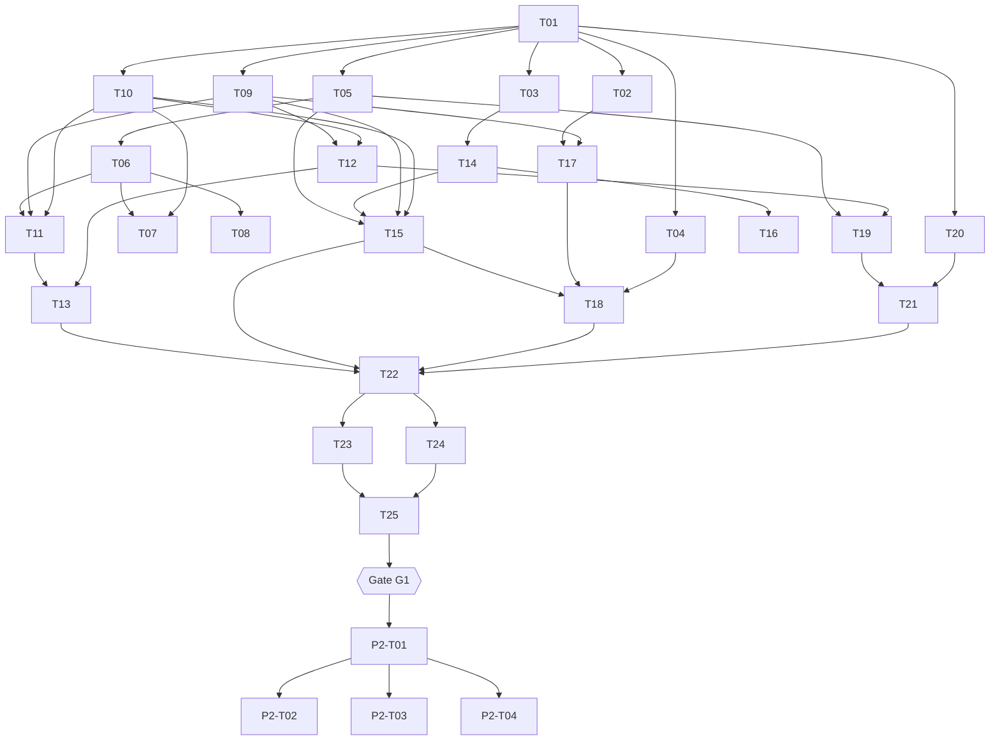

# repka: Implementation Roadmap

[← Wiki home](../README.md) · [Agent guide](AGENT-GUIDE.md)

> **For agentic workers:** REQUIRED SUB-SKILL: use `superpowers:subagent-driven-development` (recommended) or `superpowers:executing-plans` to implement this plan task by task. Read [AGENT-GUIDE.md](AGENT-GUIDE.md) first. **GitHub Issues are the only authoritative status tracker** (one issue per task, linked in the Task board below); this file keeps the static index, waves and dependencies.

**Goal:** A local macOS CLI (`repka`) that monitors GitHub repositories in user-defined technology domains, triages them with local decider models, keeps metric history and embeddings in SQLite, and sends batched morning/evening Telegram digests. Phase 2 adds a Streamlit dashboard.

**Architecture:** Hourly launchd pass → `repka run`: for each due domain, REST search with date bisection → batched GraphQL enrichment → decider worker subprocess triage → Ollama embeddings → SQLite. Digest slots decide when to build and send one Telegram message per slot. See [architecture](../spec/architecture.md).

**Tech stack:** Python ≥ 3.12, uv, argparse, httpx, PyYAML, python-dotenv, SQLite + sqlite-vec (numpy fallback), local deciders (LiquidAI d1 via transformers/MPS; Clef via MLX optional), Ollama embeddings, Telegram user account via fast-mcp-telegram + mcp, launchd. Phase 2: Streamlit, Plotly, umap-learn, scikit-learn.

**Spec:** [requirements](../spec/requirements.md) · [architecture](../spec/architecture.md) · [decisions](../spec/decisions.md)

## Global Constraints

Every task's requirements implicitly include this section.

1. **All feature flags default to `false`** (user rule). Includes `triage.enabled`, `embed.enabled`, `notify.enabled`, `run.send`, `triage.online`, `triage.allow_remote`. Installing launchd is an explicit command, never automatic.
2. **Agents commit and push themselves, no user approval needed** (user rule for this project; overrides the global "ask before committing" rule). When a task meets its Definition of Done, commit with a conventional message and push to `origin` (see [AGENT-GUIDE § 3](AGENT-GUIDE.md#3-definition-of-done-every-task)). Never force-push and never rewrite published history.
3. **Local first:** no repo data leaves the machine except GitHub API calls and the Telegram digest. No hosted model APIs unless `triage.allow_remote: true`.
4. **Tests never touch the network, GitHub, Telegram, Ollama or a model.** Use recorded JSON fixtures in `tests/fixtures/`, `httpx.MockTransport`, and injected fake callables. Optional live tests are marked `@pytest.mark.live` and skipped unless `REPKA_LIVE=1`.
5. **Secrets** (`REPKA_GITHUB_TOKEN` or the `gh` CLI token, `REPKA_TG_API_ID`/`REPKA_TG_API_HASH`, the `.sessions/` Telegram session) live only in `.env`/`.sessions/` (gitignored); never logged, stored in the DB, written to the wiki, or passed to worker/embedder subprocesses. Telegram credentials go only to the fast-mcp-telegram subprocess.
6. **Untrusted text** (repo names, descriptions, topics, READMEs, release names): `printable()` before terminal output, `html_escape()` before Telegram, passed to deciders only inside the state template.
7. **Repos are keyed by GitHub numeric id**, never by `owner/name`.
8. **No concurrency against GitHub**; search throttle `github.search_per_minute` (default 25).
9. **macOS / Apple Silicon** is the only target platform. Python ≥ 3.12 via uv. `uv.lock` committed.
10. Model revisions pinned to full 40-character commit hashes; workers run offline unless `triage.online`.
11. **No real-time alerts.** The only outbound messages are digests at configured slots; empty digests are not sent.
12. **Cost-aware sub-agents** (user rule): in agentic mode, implementation is delegated to sub-agents on the cheapest model that can do the task — **Haiku preferred**; otherwise **Sonnet advised by Opus**. See [AGENT-GUIDE § 2a](AGENT-GUIDE.md#2a-model-selection-for-sub-agents).

## Review Focus

Failure modes the requirements imply but are easy to miss. Each one has a pinning test in the owning task.

| # | Input / condition | Expected behaviour | Pinned by |
|---|---|---|---|
| RF1 | Secondary rate limit (403/429 + `Retry-After`) in the middle of a scan | Run stops GitHub work cleanly, keeps written data, run status `partial`; next run skips completed slices | P1-T10 `test_secondary_limit_raises_rate_limited`, P1-T11 `test_resume_skips_completed_slices`, P1-T22 `test_rate_limited_run_is_partial_and_continues_to_digest` |
| RF2 | A 1-day date slice still reports `total_count > 1000` | Take the first 1,000, mark `capped`, log, continue; never recurse below 1 day | P1-T11 `test_bisection_stops_at_one_day_and_caps` |
| RF3 | Repo renamed/transferred or deleted between scans | Same `repo_id` row updated (new `full_name`); GraphQL `null` node → `status='gone'`, history kept | P1-T09 `test_upsert_rename_keeps_history`, P1-T12 `test_null_node_marks_repo_gone` |
| RF4 | First scan of a repo (no older snapshot) | `stars_delta_*` is `null`, never lifetime stars; never listed as a mover | P1-T19 `test_stars_delta_null_without_baseline` |
| RF5 | Empty digest; Mac asleep through one or both slots | Empty → nothing sent, slot recorded `empty`; several due slots → only the latest is built, earlier ones `skipped`; a slot older than `max_lateness` → `skipped` | P1-T21 `test_empty_digest_not_sent`, `test_missed_slots_coalesce`, `test_stale_slot_skipped` |
| RF6 | Forks: GitHub search excludes them by default | `fork_policy` adds `fork:true` / `fork:only` explicitly; default `exclude` documented | P1-T06 `test_fork_policy_qualifier` |
| RF7 | Decider worker crashes / times out | Run continues; affected repos stay without verdict (retried next run) and are not in the digest; run status `partial` | P1-T15 `test_worker_failure_leaves_items_pending` |
| RF8 | A domain's first scan finds hundreds of long-established repos; an old repo is first found on a later scan | First scan is a **silent baseline** (no `new_repo` events). Backfill uses `pushed:>=` so active old players are found on scan 1. Later, an old repo first found is shown as 🔎 *found*, not 🆕 *new* (`created_at` older than `digest.new_max_age`) | P1-T06 `test_window_first_scan_uses_pushed`, P1-T11 `test_first_scan_is_silent_baseline`, P1-T19 `test_old_repo_found_later_is_marked_found_not_new` |
| RF9 | Core REST budget (5,000/h) exhausted by a large domain | Slow REST metrics only for accepted repos; README fetch hitting `RateLimited` leaves that item pending (stored excerpts still used) instead of failing triage | P1-T12 `test_slow_metrics_only_for_accepted`, P1-T15 `test_rate_limited_readme_leaves_item_pending` |
| RF10 | GitHub token expired or revoked (e.g. a PAT past its expiry date) | `repka doctor` names the problem and the fix for the token's source (`.env` PAT vs `gh` login); `repka run` stops before any search; a token expiring within 7 days gives a warning | P1-T10 `test_401_is_auth_error_with_env_fix`, P1-T24 `test_rejected_token_is_error_with_fix`, `test_token_expiring_soon_is_warning` |

## Milestones

| ID | Milestone | Requirements | File |
|---|---|---|---|
| M0 | Foundation & go/no-go spikes | R-G1, R-G2 | [phase-1/M0-foundation.md](phase-1/M0-foundation.md) |
| M1 | Domain Profile | R-1.1 | [phase-1/M1-domain-profile.md](phase-1/M1-domain-profile.md) |
| M2 | Store & Collector | R-1.2a, R-1.2b, R-1.4 | [phase-1/M2-collector.md](phase-1/M2-collector.md) |
| M3 | Triage (deciders) | R-1.3 | [phase-1/M3-triage.md](phase-1/M3-triage.md) |
| M4 | Embeddings & vectors | R-1.4 | [phase-1/M4-embeddings.md](phase-1/M4-embeddings.md) |
| M5 | Digest & Telegram | R-1.5, R-G3 | [phase-1/M5-digest.md](phase-1/M5-digest.md) |
| M6 | Orchestration, daemon, hardening | R-1.6 | [phase-1/M6-orchestration.md](phase-1/M6-orchestration.md) |
| — | **Gate G1: Phase 1 stable** | — | see [below](#gate-g1-phase-1-is-stable) |
| M7 | Dashboard (Phase 2) | R-2.1, R-2.2, R-2.3 | [phase-2/M7-dashboard.md](phase-2/M7-dashboard.md) |

## Task board

Status lives in the linked GitHub issue ([status mapping](AGENT-GUIDE.md#5-status-values)). Size: S ≈ < 300 LOC incl. tests, M ≈ 300–700, L ≈ > 700.

| ID | Issue | Task | Wave | Depends on | Size | Notes |
|---|---|---|---|---|---|---|
| [P1-T01](phase-1/M0-foundation.md#p1-t01-project-scaffold-config-and-agent-guide) | [#1](https://github.com/ast-ashulga/as.repka.deda/issues/1) | Project scaffold, config, CLAUDE.md | 1 | — | M | |
| [P1-T02](phase-1/M0-foundation.md#p1-t02-spike-sqlite-vec-loads-under-uv-python) | [#2](https://github.com/ast-ashulga/as.repka.deda/issues/2) | Spike: sqlite-vec under uv Python | 2 | T01 | S | Verdict: NO-GO for vec0 (extension loads; numpy ~20-28x faster at 5k-50k). See [spike](../spikes/T02-sqlite-vec.md) |
| [P1-T03](phase-1/M0-foundation.md#p1-t03-spike-local-decider-runs-on-this-mac) | [#3](https://github.com/ast-ashulga/as.repka.deda/issues/3) | Spike: local decider on this Mac | 2 | T01 | M | needs ~6 GB disk; human may need to run downloads |
| [P1-T04](phase-1/M0-foundation.md#p1-t04-spike-ollama-embedder-returns-vectors) | [#4](https://github.com/ast-ashulga/as.repka.deda/issues/4) | Spike: Ollama embedder | 2 | T01 | S | needs Ollama installed |
| [P1-T05](phase-1/M1-domain-profile.md#p1-t05-domain-schema-loader-and-listshow) | [#5](https://github.com/ast-ashulga/as.repka.deda/issues/5) | Domain schema, loader, `domain list/show` | 2 | T01 | S | |
| [P1-T06](phase-1/M1-domain-profile.md#p1-t06-query-matrix-and-domain-plan) | [#6](https://github.com/ast-ashulga/as.repka.deda/issues/6) | Query matrix, `domain plan` | 3 | T05 | M | |
| [P1-T07](phase-1/M1-domain-profile.md#p1-t07-interactive-wizard-domain-new) | [#7](https://github.com/ast-ashulga/as.repka.deda/issues/7) | Wizard `domain new` | 4 | T06, T10 | M | |
| [P1-T08](phase-1/M1-domain-profile.md#p1-t08-claude-code-skill-domain-profile) | [#8](https://github.com/ast-ashulga/as.repka.deda/issues/8) | Claude Code skill `domain-profile` | 4 | T06 | S | |
| [P1-T09](phase-1/M2-collector.md#p1-t09-sqlite-store-migrations-and-repositories) | [#9](https://github.com/ast-ashulga/as.repka.deda/issues/9) | SQLite store, migrations, `db stats` | 2 | T01 | M | |
| [P1-T10](phase-1/M2-collector.md#p1-t10-github-http-client) | [#10](https://github.com/ast-ashulga/as.repka.deda/issues/10) | GitHub HTTP client | 2 | T01 | M | |
| [P1-T11](phase-1/M2-collector.md#p1-t11-search-with-pagination-and-date-bisection) | [#11](https://github.com/ast-ashulga/as.repka.deda/issues/11) | Search + pagination + bisection | 4 | T06, T09, T10 | M | |
| [P1-T12](phase-1/M2-collector.md#p1-t12-enrichment-snapshots-key-files-stack-events) | [#12](https://github.com/ast-ashulga/as.repka.deda/issues/12) | Enrichment, snapshots, key files, events | 3 | T09, T10 | L | |
| [P1-T13](phase-1/M2-collector.md#p1-t13-repka-collect-command) | [#13](https://github.com/ast-ashulga/as.repka.deda/issues/13) | `repka collect` | 5 | T11, T12 | S | |
| [P1-T14](phase-1/M3-triage.md#p1-t14-port-the-decider-runtime) | [#14](https://github.com/ast-ashulga/as.repka.deda/issues/14) | Port decider runtime (`deciders/`) | 3 | T03 | M | |
| [P1-T15](phase-1/M3-triage.md#p1-t15-repository-triage-and-repka-triage) | [#15](https://github.com/ast-ashulga/as.repka.deda/issues/15) | Repo triage + `repka triage` | 4 | T05, T09, T10, T14 | M | |
| [P1-T16](phase-1/M3-triage.md#p1-t16-optional-clef-mlx-worker) | [#16](https://github.com/ast-ashulga/as.repka.deda/issues/16) | (Optional) Clef MLX worker | 4 | T14 | M | only if T03 Clef part = GO |
| [P1-T17](phase-1/M4-embeddings.md#p1-t17-vector-store-with-fallback) | [#17](https://github.com/ast-ashulga/as.repka.deda/issues/17) | Vector store with fallback | 3 | T02, T09 | S | |
| [P1-T18](phase-1/M4-embeddings.md#p1-t18-ollama-embedder-repka-embed-and-repka-similar) | [#18](https://github.com/ast-ashulga/as.repka.deda/issues/18) | Ollama embedder, `embed`, `similar` | 5 | T04, T15, T17 | M | |
| [P1-T19](phase-1/M5-digest.md#p1-t19-metrics-and-digest-builder) | [#19](https://github.com/ast-ashulga/as.repka.deda/issues/19) | Metrics + digest builder/renderer | 4 | T05, T12 | M | |
| [P1-T20](phase-1/M5-digest.md#p1-t20-telegram-sender-user-account-via-fast-mcp-telegram) | [#20](https://github.com/ast-ashulga/as.repka.deda/issues/20) | Telegram user-account sender, `notify login/test` | 2 | T01 | M | |
| [P1-T21](phase-1/M5-digest.md#p1-t21-digest-slots-and-repka-digest) | [#21](https://github.com/ast-ashulga/as.repka.deda/issues/21) | Slots + `repka digest` | 5 | T19, T20 | M | |
| [P1-T22](phase-1/M6-orchestration.md#p1-t22-repka-run-pipeline) | [#22](https://github.com/ast-ashulga/as.repka.deda/issues/22) | `repka run` pipeline | 6 | T13, T15, T18, T21 | M | |
| [P1-T23](phase-1/M6-orchestration.md#p1-t23-launchd-schedule) | [#23](https://github.com/ast-ashulga/as.repka.deda/issues/23) | launchd `schedule` | 7 | T22 | S | |
| [P1-T24](phase-1/M6-orchestration.md#p1-t24-preflight-and-doctor) | [#24](https://github.com/ast-ashulga/as.repka.deda/issues/24) | Preflight + `doctor` | 7 | T22 | M | |
| [P1-T25](phase-1/M6-orchestration.md#p1-t25-end-to-end-rehearsal-and-readme) | [#25](https://github.com/ast-ashulga/as.repka.deda/issues/25) | E2E rehearsal + README | 8 | T23, T24 | M | partly human (real tokens) |
| [P2-T01](phase-2/M7-dashboard.md#p2-t01-dashboard-skeleton-and-data-layer) | [#26](https://github.com/ast-ashulga/as.repka.deda/issues/26) | Dashboard skeleton + data layer | 9 | G1 | M | |
| [P2-T02](phase-2/M7-dashboard.md#p2-t02-domain-management-page) | [#27](https://github.com/ast-ashulga/as.repka.deda/issues/27) | Domain management page | 10 | P2-T01 | M | |
| [P2-T03](phase-2/M7-dashboard.md#p2-t03-landscape-map) | [#28](https://github.com/ast-ashulga/as.repka.deda/issues/28) | Landscape map (UMAP + clusters) | 10 | P2-T01 | L | |
| [P2-T04](phase-2/M7-dashboard.md#p2-t04-analytics-charts) | [#29](https://github.com/ast-ashulga/as.repka.deda/issues/29) | Analytics charts | 10 | P2-T01 | M | |

(Task IDs in "Depends on" omit the `P1-` prefix.)

## Dependency graph

Critical path: T01 → T05 → T06 → T11 → T13 → T22 → T24 → T25.

## Gate G1: Phase 1 is stable

Phase 2 starts only when a human confirms all of:
- [ ] `repka run` scheduled by launchd for **7 consecutive days** with no `failed` runs (`repka db stats` shows them).
- [ ] At least 2 domains configured; each scanned on its schedule.
- [ ] ≥ 10 digests delivered; no duplicate digest per slot; no empty digest sent.
- [ ] Triage spot-check: a human labels 30 accepted + 30 rejected repos; precision of `accepted` ≥ 0.8 (record result in Notes). If below, tune thresholds/questions before Phase 2.
- [ ] Phase 2 tasks re-read and refined (see [M7](phase-2/M7-dashboard.md)) with what Phase 1 taught.

## Requirement coverage

| Req | Tasks |
|---|---|
| R-G1 | T01, T22, T25 |
| R-G2 | T02, T03, T04, T14, T16, T18, T23 |
| R-G3 | T21 (slots, no empty sends), Global Constraint 11 |
| R-1.1 | T05, T06, T07, T08 |
| R-1.2a | T10, T11, T13 |
| R-1.2b | T12 (stars, forks, contributors, commit regularity, releases, key files + stack), T19 (deltas) |
| R-1.3 | T03, T14, T15, T16 |
| R-1.4 | T02, T09, T12, T17, T18 |
| R-1.5 | T19, T20, T21 |
| R-1.6 | T22, T23, T24, T25 |
| R-2.1 | P2-T02 |
| R-2.2 | P2-T03 |
| R-2.3 | P2-T04 (uses T12 stack data, T19 metrics) |
