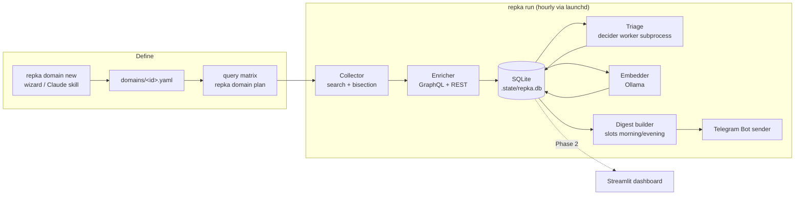

# Architecture (Phase 1 contract)

[← Wiki home](../README.md) · Prev: [requirements](requirements.md) · Next: [decisions](decisions.md)

This page is the **shared contract** for every implementing agent: paths, config keys, table names, core types and CLI commands. If a task needs to deviate, it updates this page in the same change and says so in its report.

## 1. Overview



One `repka run` pass: preflight → lock → for each **due** domain: collect → enrich → triage → embed → then, if a **digest slot** is due: build digest → send (only if enabled and non-empty) → record.

## 2. Repository layout

```
as.repka.deda/
├── pyproject.toml            # package "repka", script "repka = repka.cli:main"
├── uv.lock                   # committed
├── .config.yaml              # tracked, example values, all flags false
├── .env.example              # REPKA_GITHUB_TOKEN= (optional), REPKA_TG_API_ID=, REPKA_TG_API_HASH=
├── .sessions/                # Telegram session (gitignored, 0700; created by `repka notify login`)
├── CLAUDE.md                 # agent guide for the codebase (created in P1-T01)
├── domains/                  # one YAML per domain (tracked examples: example-mcp.yaml)
├── deciders/                 # copied/adapted from as.tegerun.cli/classifier
│   ├── models.yaml  questions.yaml  setup.sh  fetch.py  README.md
│   └── workers/ d1_worker.py  pplx_worker.py  (clef_mlx_worker.py if spike passes)
├── .claude/skills/domain-profile/SKILL.md   # Claude Code interview skill (P1-T08)
├── src/repka/
│   ├── cli.py                # argparse; subcommands; error → exit codes
│   ├── config.py             # PROJECT_ROOT, load_* per section, ConfigError, env builders
│   ├── textutil.py           # printable(), html_escape(), truncate()
│   ├── runlock.py            # RunLock (flock .state/run.lock)
│   ├── preflight.py          # Finding, check()
│   ├── models.py             # shared dataclasses (§ 6)
│   ├── domain/  schema.py  matrix.py  wizard.py  suggest.py
│   ├── github/  client.py  search.py  enrich.py  stack.py
│   ├── store/   db.py  repo.py  vectors.py  metrics.py  migrations/NNN_*.sql
│   ├── triage/  deciders.py  triage.py
│   ├── embed/   ollama.py  embed.py
│   ├── digest/  build.py  render.py  slots.py  run.py  cli.py
│   ├── notify/  mcp_client.py  telegram_user.py  cli.py
│   ├── logging_setup.py      # stderr + rotating logs/repka.log
│   ├── collect.py            # due_domains(), collect_domains() (+ collect_cli.py)
│   ├── schedule.py           # launchd plist install/uninstall
│   ├── pipeline.py           # run_pass() with injected boundaries (+ run_cli.py)
│   └── dashboard_data.py     # Phase 2 data layer: read-only, except store_landscape (Recompute only)
├── dashboard/                # Phase 2 (Streamlit): app.py (home), pages/ (1_Domains.py writes domain YAML via domain.schema only; 2_Landscape.py is the only DB writer, through its Recompute button; see §4 landscape_cache and ADR-008)
├── scripts/                  # spike scripts (not part of the package)
├── tests/                    # pytest; fixtures/github/*.json recorded responses
├── .state/  logs/            # gitignored
└── wiki/                     # these docs
```

## 3. Configuration

### 3.1 `.env` (gitignored; never logged; never passed to worker subprocesses)

| Var | Used by |
|---|---|
| `REPKA_GITHUB_TOKEN` (optional) | github client; empty → `gh auth token` |
| `REPKA_TG_API_ID`, `REPKA_TG_API_HASH` | telegram sender (Telegram app credentials; passed only to the fast-mcp-telegram subprocess) |
| `REPKA_HOME` (optional) | overrides `PROJECT_ROOT` |

### 3.2 `.config.yaml` (tracked; every key optional; defaults shown; **all booleans default `false`**)

```yaml
github:
  search_per_minute: 25        # client throttle for search endpoints (GitHub max 30)
  per_page: 100
  timeout_s: 30
collect:
  first_window: 365d           # backfill window on a domain's first scan (pushed:>=); first scan is a silent baseline
  overlap: 1d                  # incremental scans use pushed:>= last_scan - overlap
  max_repos_per_domain_scan: 3000
  enrich_batch: 50             # GraphQL nodes per query
  slow_metrics_every: 7d       # contributors + participation refresh period
triage:
  enabled: false
  model: d1-3B                 # name in deciders/models.yaml
  deciders_dir: deciders
  timeout_s: 1800
  online: false                # allow HF downloads inside workers
  allow_remote: false          # permit remote decider backends (e.g. hosted Jev) — never default
  readme_chars: 4000
  thresholds: {relevant: 0.70, substance: 2}
embed:
  enabled: false
  backend: ollama
  model: nomic-embed-text
  url: http://localhost:11434
  batch: 32
digest:
  slots: ["08:30", "19:30"]    # local time
  max_lateness: 6h
  max_items_per_domain: 10
  new_max_age: 90d             # a first-seen repo created within this age is "new" (🆕), older ones are "found" (🔎)
  star_spike_min_delta: 50     # stars_delta_1d threshold for the "top movers" digest section
  insights: false              # digest insights section; enable together with releases_message (doctor warns if only one is on)
  releases_message: false      # separate releases message at releases_slot
  releases_slot: "09:00"       # local time HH:MM for the releases message
  facet_min_p: 0.7             # minimum probability (0 < p <= 1) for an insight facet to be shown
  pending_max_age: 7d          # a pending insight expires after this age
notify:
  enabled: false
  backend: telegram_user       # own account via fast-mcp-telegram (ADR-005)
  chat_id: "me"                # "me" = Saved Messages; or numeric id / @username
  topic_id: null
run:
  send: false                  # second switch: digests are sent only if notify.enabled AND run.send (or --send)
  log_level: INFO
```

Validation follows the reference: one `load_<section>(raw) -> <Section>Config` per section, strict types (a boolean must be a YAML boolean), unknown keys rejected with a `ConfigError` naming the key. Durations parse `30m|12h|7d`.

### 3.3 Domain file `domains/<id>.yaml`

```yaml
id: mcp-servers                # slug [a-z0-9-]{2,40}; must equal the file stem
name: "MCP servers & tooling"
enabled: true                  # a domain file's own on/off (domain-level, not a feature flag)
scan_every: 12h
profile: |                     # detailed description; fed to the deciders as {domain_profile}
  Model Context Protocol servers, clients, SDKs and gateways ...
search:
  keywords:                    # each entry = one keyword group (ORed inside the group)
    - ["model context protocol", "mcp server"]
    - ["mcp client", "mcp sdk"]
  topics: [mcp, model-context-protocol]
  languages: [Python, TypeScript, Go, Rust]   # [] = no language qualifier
  exclude: ["minecraft"]                      # -> NOT "minecraft"
  min_stars: 5
  in: [name, description, readme]   # `name` is dropped from keyword groups that contain a phrase (GitHub returns 0 hits otherwise)
  fork_policy: exclude         # exclude | include | only
key_files: [pyproject.toml, package.json, Cargo.toml, go.mod]
triage:
  questions: {}                # optional overrides/additions, same schema as deciders/questions.yaml
```

## 4. Data model (SQLite)

Created by migrations in `src/repka/store/migrations/`. All timestamps are UTC ISO-8601 strings (`2026-11-07T08:30:00Z`). JSON columns are TEXT.

| Table | Columns (PK **bold**) | Notes |
|---|---|---|
| `schema_version` | **version** INT | |
| `domains` | **id** TEXT, name, profile_hash, scan_every_s INT, last_scan_at, last_scan_status | mirror of YAML runtime state; YAML is the source of truth for definitions |
| `repos` | **repo_id** INT (GitHub id), node_id UNIQUE, full_name, html_url, description, language, topics_json, license, is_fork INT, parent_full_name, created_at, pushed_at, archived INT, first_seen_at, last_seen_at, status TEXT `active`/`gone`, readme_excerpt NULL, readme_fetched_at NULL, contributors_at NULL, participation_at NULL | `contributors_at`/`participation_at` (migration 002, P1-T12) = when each slow REST metric was last fetched successfully; `snapshots` carry the last values forward, so this is what decides a refresh. `full_name` mutable; README excerpt stored by triage (≤ `triage.readme_chars`) and reused by embeddings |
| `domain_repos` | **domain_id, repo_id**, first_matched_at, last_matched_at, query_keys_json | |
| `snapshots` | **repo_id, taken_at**, stars, forks, open_issues, watchers, contributors NULL, commits_7d, commits_30d, active_weeks_12 NULL, releases_90d, latest_release_tag, latest_release_at | one row per enrichment |
| `key_files` | **repo_id, path, blob_oid**, deps_json, first_seen_at | a new oid row = file changed |
| `events` | **id** INT AUTO, repo_id, domain_id NULL, kind TEXT, payload_json, detected_at, digest_id NULL | kinds: `new_repo`, `release`, `key_file_changed`, `stack_changed` (star movers are computed from `snapshots` at digest time, not stored as events) |
| `verdicts` | **repo_id, domain_id, model, questions_hash**, input_hash, answers_json, accepted INT, decided_at | latest per key |
| `embeddings` | **repo_id, model**, dim INT, input_hash, vector BLOB (float32 LE), created_at | source of truth for vectors |
| ~~`vec_index_<model_slug>`~~ | not created: no `vec0` index (P1-T02 NO-GO); KNN is numpy brute force over `embeddings` | deviation, see [P1-T17](../plans/phase-1/M4-embeddings.md#p1-t17-vector-store-with-fallback) |
| `landscape_cache` | **domain_id, model, method**, params_hash, computed_at, payload (JSON: repo_ids, x, y, cluster, terms) | migration 003 (P2-T03): cached UMAP projection + HDBSCAN clusters for the dashboard landscape map. `params_hash` = sha256 of the projected vectors' content (ids + bytes of the one model's matrix) and of method/seed/min_cluster_size, so changed vectors or parameters make the row stale. Written only by the dashboard's Landscape **Recompute** button (`landscape.py` is pure; `dashboard_data.compute_landscape` reads on a read-only connection, then Recompute opens a writable connection, runs `migrate()`, and calls `store_landscape`, one upsert that commits; nothing is written when there are no embeddings). `migrate()` is race-safe against a concurrent `repka run` migration (write lock, then version re-read); see ADR-008 amendment |
| `search_cursor` | **domain_id, query_key, slice**, completed_at, total_count, capped INT | resume after rate limit |
| `http_cache` | **url**, etag, body, fetched_at | conditional REST requests |
| `digests` | **id** INT AUTO, slot TEXT, local_date TEXT, status `sent`/`empty`/`skipped`/`failed`/`preview`, item_count, sent_at, kind TEXT `main`/`releases`; UNIQUE(slot, local_date) | `preview` rows are never written (preview changes no state). `kind` (migration 004, default `main`): the releases message is its own row with `slot = 'releases:HH:MM'`, so the unique key keeps it apart from a main row of the same time |
| `digest_items` | **digest_id, repo_id, kind** | what each sent digest showed; used to show a "mover" at most once per 24 h |
| `runs` | **id** INT AUTO, kind TEXT, started_at, finished_at, status `ok`/`partial`/`failed` (NULL while running), stats_json, error | `kind` added in P1-T09 so `start_run(kind)` can be stored |

## 5. Pipeline semantics

1. **Collect** (`github/search.py`): for each query in the matrix and each date slice (`pushed:` window), page through results; upsert `repos` + `domain_repos`; on first sighting in the domain emit `new_repo` — **except on the domain's first scan**, which is a silent baseline. Mark slice in `search_cursor`. An unfinished scan keeps its window (stored in `search_cursor` under the pseudo query key `_window`) until it completes, because slice keys contain the window dates; `collect.max_repos_per_domain_scan` counts unique repos.
2. **Enrich** (`github/enrich.py`): repos of the domain seen in this scan + all accepted repos of the domain (to track metrics of known players) → GraphQL batches → `snapshots`, `key_files`; emit `release` (new `latest_release_tag`), `key_file_changed` (new oid, not first sighting), `stack_changed` (deps diff non-empty). Snapshots and key files are per repo, so each event is written for **every domain linked to the repo** (key-file/stack events only for domains whose `key_files` list the path). Slow REST metrics (contributors, participation) are fetched **only for accepted repos**, refreshed every `collect.slow_metrics_every` (protects the 5,000/h core budget).
3. **Triage** (`triage/triage.py`): repos of the domain without a verdict for `(model, questions_hash, input_hash)` → one worker run → `verdicts`. `accepted = passes all thresholds`; every triage pass re-applies the current `triage.thresholds` to the stored `answers_json` (`reclassify`, no model run), so editing a threshold flips old verdicts on the next pass. README excerpts come from `repos.readme_excerpt` when fresh; a README fetch that hits `RateLimited` leaves that repo pending for the next run.
4. **Embed** (`embed/embed.py`): accepted repos without an embedding for `(model, input_hash)`.
5. **Digest** (`digest/*`): only events of **accepted** repos (or `new_repo` events whose repo got accepted) with `digest_id IS NULL`, plus a "top movers" section (accepted repos with `stars_delta_1d >= digest.star_spike_min_delta`, computed from snapshots), grouped by domain, ranked; after a real send, events get `digest_id`. The builder is a pure read: it returns `shown_event_ids` and `consumed_event_ids` (rejected, bare `key_file_changed`, overflow) for the sender to stamp. A `stars_delta` whose baseline would be the latest snapshot itself is `null` (one snapshot proves no growth); `velocity` counts NULL inputs (e.g. after a failed slow-metric refresh) as 0.

**Digest insights and the releases message (`digest.insights`, `digest.releases_message`; both default `false`, design: `wiki/spec/2026-11-10-digest-insights-design.md`).** Both off: the digest is exactly as described above.
- `insights: true`: the main digest uses the insights format (`render.py`): per item a description line, `kind · lvl N` and up to three facet tags, then a one-line legend and an `…and N more: 5 🆕, 7 🔎 (repka digest --more)` counter. Facet tags (`build.facet_tags`) come from the repo's latest verdict in the domain: `noul` answers outside the base questions (`relevant`, `substance`, `kind`, `is_junk`) with `p >= digest.facet_min_p`, best first, at most 3; a repo without such answers is shown without tags. Overflow `new`/`found`/`release` items are **not** consumed (releases fill last and share the per-domain limit, so without this they would be lost whenever the new group fills it): they stay pending (`digest_id IS NULL`) and show up in a later digest or in `repka digest --more`, until `digest.pending_max_age` (a `new_repo` or `release` event older than that is consumed silently). Overflow `stack` items are still consumed as before (movers carry no events).
- `releases_message: true`: `release` events belong to a separate daily message (`digest/releases.py`, run by `pipeline` after the digest stage, slot `digest.releases_slot`, same `digest.max_lateness` rule). The main digest neither shows nor consumes them, rejected repos included. The message lists per domain the newest release per accepted repo (`★stars · tag`), most stars first, up to `digest.max_items_per_domain` lines, then `…and N more` and `Full list: repka releases --since 24h`; older releases of a repo and releases of rejected repos are consumed with it. Events of repos without a verdict stay pending. Nothing to show means nothing is sent (the slot is recorded `empty`). `events.digest_id` is stamped only after a real delivery, in one transaction with the `sent` row, so a failed send or a skipped slot loses nothing.
- `digests.kind` / slot-prefix rule: the unique key stays `(slot, local_date)`. A `main` row stores the plain slot (`08:30`); a `releases` row stores `slot = 'releases:HH:MM'` and `kind = 'releases'` (`slots.slot_key`; `recorded_slots(kind=...)` strips the prefix). Migration 004 adds the `kind` column (default `main`), no table rebuild.

| `insights` | `releases_message` | Result |
|---|---|---|
| false | false | as before; nothing changes |
| true | false | insights format of the main digest; releases stay in it, last in the section and inside the shared per-domain limit |
| false | true | old main digest format without releases; releases go out as the separate message |
| true | true | the target setup: insights main digest without 🚀, plus the daily releases message |

`repka doctor` warns (not an error) when only one of the two flags is on.

Locking: `run`, `collect`, `digest --send`, `triage` and `embed` (non-dry-run) share `.state/run.lock`; a busy lock exits 0 with a message. `run --send` with `--domain` is refused (a digest consumes the slot for all domains). A failure in one domain's collect/triage/embed is recorded in the report and the other domains still run; a crashed worker or Ollama outage ends that stage; `RateLimited` ends GitHub work; `AuthError` aborts.

Rate-limit behaviour: a `RateLimited` exception from the GitHub client stops collection/enrichment for **all** domains in this run, keeps everything already written, sets the run status `partial`, and the pipeline proceeds to triage/digest with what it has.

**Run pass and status (`pipeline.py`, P1-T22).** `run_pass` runs collect (enabled domains; the real boundary filters to the due ones and builds no GitHub client when nothing is due) → triage (every enabled domain, only if `triage.enabled`; stops at the first `WorkerError`) → embed (only if `embed.enabled`) → digest (always evaluated; delivered only if `send`) → releases message (only if `digest.releases_message`; same `send` rule, its own `PassReport.releases` outcome, a failed send makes the pass `partial`). Each stage's exception is caught, logged and appended to `errors`; the next stage still runs. Status: `failed` only if every stage that ran raised an unexpected exception; otherwise `partial` if anything went wrong or was left unfinished (an exception such as `RateLimited`/`WorkerError`/`EmbedderUnavailable`, a collect domain that is `partial`/`skipped` (rate limit, `max_repos_per_domain_scan`), triage `errors` or a rate-limited README fetch, a digest `failed` send or a failed later part); else `ok`. The CLI holds `.state/run.lock` (a second run exits 0), migrates, records `start_run`/`finish_run` (`runs.kind = 'run'`, `stats_json` = per-stage stats without digest text) and closes the lazily built GitHub client / embedder.

**Silent baseline and release events (P1-T22).** The first scan of a domain is silent, and that includes `release` events: `enrich_repos(..., baseline=True)` (passed by `collect` while the domain has no complete baseline, i.e. `last_scan_at` is unset) emits no `release` event for a repo that has no earlier snapshot, which used to produce one event per repo whose latest release was <= 7 days old and flooded the first digest. The snapshot (and its `latest_release_tag`) is still stored, so only a later new tag becomes an event; a repo that already had a snapshot (e.g. from another domain) can still emit one. Existing databases keep any release events written before this change (not migrated; they surface once, in the first digest after triage).

**Scan bookkeeping (`collect.py`, P1-T13).**
- `domains.last_scan_at` advances **only when a scan completes** (`last_scan_status = ok`). A `partial` scan (rate limit, GitHub error, or `collect.max_repos_per_domain_scan` reached) records the status and leaves `last_scan_at` untouched. So "`last_scan_at` is set" means "a complete baseline exists": an interrupted first scan stays a silent baseline (no `new_repo` events) until one scan completes, and the scan window of later scans starts at the stored `last_scan_at − overlap`.
- A domain whose last scan was `partial` is due again immediately (to resume), otherwise `scan_every` after `last_scan_at`.
- `search_cursor` rows exist only for an **unfinished** scan: the next run skips their slices (RF1) and they are deleted when a scan completes. Consequences: a forced rerun (`--domain`) right after a complete scan searches again instead of skipping everything; a resume that crosses UTC midnight uses new slice keys (the window end date changed, and on a first scan the start too) and re-reads the window, which is harmless (upserts are idempotent, `new_repo` is emitted only on first sighting in the domain).
- Enrichment targets of a scan: repos matched after their latest snapshot (this scan's finds, and finds of an earlier interrupted run that never got enriched; repos already snapshotted by that run are not redone), repos with no snapshot, and all accepted repos; `gone` repos are skipped. Slow metrics only for the accepted ones. The whole run uses one `now`.

## 6. Core types (`src/repka/models.py`)

Frozen dataclasses shared across modules (fields listed; types in the owning task):

- `RepoHit(repo_id, node_id, full_name, html_url, description, language, topics, stars, forks, is_fork, created_at, pushed_at, archived, license)` — from search.
- `Snapshot(repo_id, taken_at, stars, forks, open_issues, watchers, contributors, commits_7d, commits_30d, active_weeks_12, releases_90d, latest_release_tag, latest_release_at)`.
- `KeyFile(repo_id, path, blob_oid, text | None)`.
- `Event(repo_id, domain_id, kind, payload: dict, detected_at)`.
- `TriageItem(repo_id, domain_id, state: str, input_hash: str)`.
- `Verdict(repo_id, domain_id, model, questions_hash, input_hash, answers: dict, accepted: bool)`. `answers` (stored as `verdicts.answers_json`) maps question id → normalized answer exactly as `normalize_answer` returns it:
  ```json
  {"relevant":  {"type": "noul",   "p": 0.91, "pred": true, "conf": 0.91},
   "substance": {"type": "score",  "pred": 3, "score": 2.8, "conf": 0.62, "probs": {"0": 0.01, "1": 0.05, "2": 0.2, "3": 0.6, "4": 0.14}},
   "kind":      {"type": "choice", "pred": "tool", "conf": 0.77, "probs": {"tool": 0.77, "library": 0.15, "other": 0.08}}}
  ```
  (JSON object keys are strings; score levels are parsed back to `int` on read.)
- `DigestItem(domain_id, repo_id, full_name, html_url, line_kind, text_fields: dict, rank_score: float)`.

## 7. CLI surface (Phase 1)

| Command | Purpose | Task |
|---|---|---|
| `repka doctor [--send] [--json]` | preflight: one line per check (`ok`/`warn`/`error`, check id, finding, `-> fix:` command), then a numbered to-do list of the problems (errors first); `--json`: `{ok, errors, warnings, checks[{id,status,title,fix}]}`. Checks: GitHub token (`.env` or `gh`) and one `GET /user` (expired/revoked: error with the fix for the token's source; expiring within 7 days or unreachable: warning), enabled domains, triage model/venv/weights/thresholds (if `triage.enabled`), `ollama` on PATH (if `embed.enabled`), Telegram credentials/session/chat (if sending), warnings when triage or sending is off. Reads files only, loads no model. Exit 2 on errors, else 0. `repka run` runs the same checks before the lock: it prints the list to stderr and exits 2 on errors, warnings continue | P1-T24 |
| `repka domain new [--from-file PATH] [--probe]` | interactive wizard (answers may be piped, one per line) → `domains/<id>.yaml`; `--probe` counts GitHub results per query (network) | P1-T07 |
| `repka domain list` / `show <id>` / `plan <id> [--json]` | inspect domains and expanded query matrix | P1-T05/T06 |
| `repka collect [--domain ID] [--dry-run] [--json]` | search + enrich due (or given) domains; progress on stderr, summary (or `--json`) on stdout; takes `.state/run.lock`; a rate limit ends the run `partial` with exit 0 | P1-T13 |
| `repka triage [--domain ID] [--limit N] [--dry-run] [--json]` | run deciders on pending repos (all enabled domains, or one); summary + table `repo · relevant p · substance · kind · accepted` on stdout; runs even when `triage.enabled` is false (stderr note: that flag only governs `repka run`); `--dry-run` prints the pending count and the first model input, loads no model, writes nothing; worker crash → `error:` + exit 1, repos stay pending | P1-T15 |
| `repka embed [--domain ID] [--json]` | embed accepted repos of the domain (all enabled domains by default) whose text changed; Ollama `embed.model` at `embed.url`, batches of `embed.batch`, committed per batch; runs even when `embed.enabled` is false (stderr note); summary per domain on stdout; Ollama down → `error:` + exit 1, model missing → exit 2 | P1-T18 |
| `repka similar <owner/name> [-k 10] [--domain ID] [--json]` | nearest repos by the repo's stored embedding (cosine, self excluded; `--domain` restricts candidates to accepted repos of that domain); reads the DB only, Ollama not needed; unknown repo or no embedding → exit 2 | P1-T18 |
| `repka digest [--slot HH:MM] [--send] [--dry-run] [--more]` | preview the pending digest on stdout (default and `--dry-run`: read-only connection, nothing sent or written); when no slot is due, the CLI previews the latest passed slot anyway (stderr note). `--send` needs `notify.enabled: true` (exit 2 otherwise), sends the due slot and records it. `--more` (exclusive with `--send`/`--dry-run`): read-only list of the items waiting in the queue: the unlimited build restricted to `new`/`found`/`release` (so after a send it lists exactly what was held back; stack and mover items are not queue items), rendered like the digest; prints `nothing waiting in the queue` when there are none. On a database older than this repka (a read-only path) it exits 2 with a hint to run `repka run` or `repka db migrate`; `--send` migrates first | P1-T21 |
| `repka releases [--since DURATION] [--domain ID]` | read-only: the newest `release` event per accepted repo in the window (default `24h`, `30m`/`12h`/`7d`), one section per enabled domain, `★stars  owner/name  tag  published_at`, most stars first. Sent and pending events both count; nothing is sent or marked | digest insights |
| `repka notify login` | one-time interactive Telegram login (`fast-mcp-telegram-setup`; session in `.sessions/telegram.session`) | P1-T20 |
| `repka notify test "text" [--dry-run]` | send one HTML-escaped message to `notify.chat_id`; refused (exit 2) unless `notify.enabled: true`; `--dry-run` opens no session | P1-T20 |
| `repka run [--send] [--domain ID] [--json]` | one full pass (what launchd calls): collect (due domains) → triage (`triage.enabled`) → embed (`embed.enabled`) → digest (always built; sent only with `--send`/`run.send`, which needs `notify.enabled`, else exit 2 before any work) → releases message (if `digest.releases_message`; the summary has a `releases` line and `--json` a `releases` object). Progress on stderr, summary + hints on stdout (`--json`: full report incl. digest text on stdout, one summary line on stderr). `--domain` forces that (enabled) domain. Status `ok`/`partial`/`failed` recorded in `runs`; exit 0 for ok and partial, 1 for failed, 2 for config errors; a busy `.state/run.lock` → message + exit 0 | P1-T22 |
| `repka schedule install [--dry-run] [--interval 1h]\|uninstall\|status` | one launchd user agent `com.repka.run` (`~/Library/LaunchAgents/com.repka.run.plist`) running `uv run --project <root> repka run` every interval; no secrets in the plist, only `EnvironmentVariables` `PATH` (current PATH + the dir of `gh`, since launchd's default lacks it) and `REPKA_HOME` when set; `logs/launchd.log`. `install` replaces an existing agent (bootout, then bootstrap); `uninstall` and re-install are idempotent; `install` warns (exit 0) when notify or run.send is off. Only these commands touch launchd (never automatic); exit 1 when launchctl refuses | P1-T23 |
| `repka db migrate` | create or upgrade `.state/repka.db` (idempotent) | P1-T09 |
| `repka db stats` | row counts, last runs | P1-T09 |
| `repka dashboard [--port 8501]` | Streamlit dashboard (ADR-008) on `127.0.0.1` only, read-only except domain YAML writes (Domains page) and the Landscape Recompute (`landscape_cache` upsert, after `migrate()`); needs `uv sync --group dashboard` (exit 2 with that hint otherwise). The Home page also lists both digest kinds (`main`, `releases`), the pending queue (`pending_overflow`, plus `build_releases` when `digest.releases_message`) and recent releases (the `repka releases` query) | P2-T01 |

Exit codes: `0` ok; `1` runtime failure (worker crash, network after retries); `2` configuration/usage error (`ConfigError`, `ValueError`). stdout = results (`--json` where offered); stderr = progress and logs. Logs also go to `logs/repka.log` (rotating, 5 × 1 MB).
